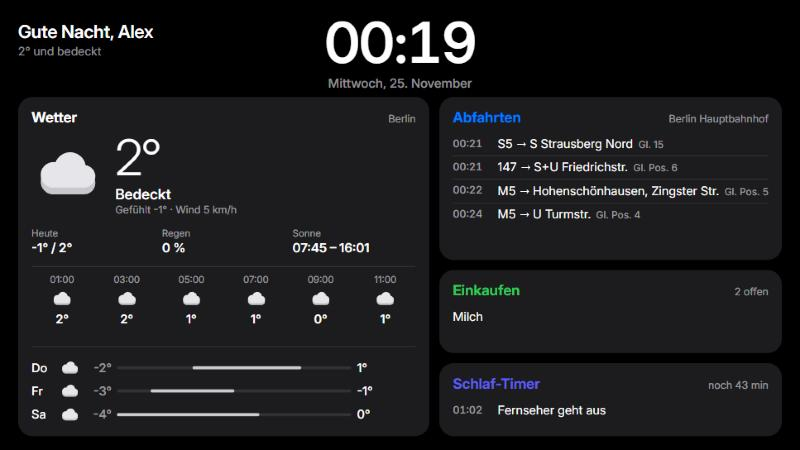
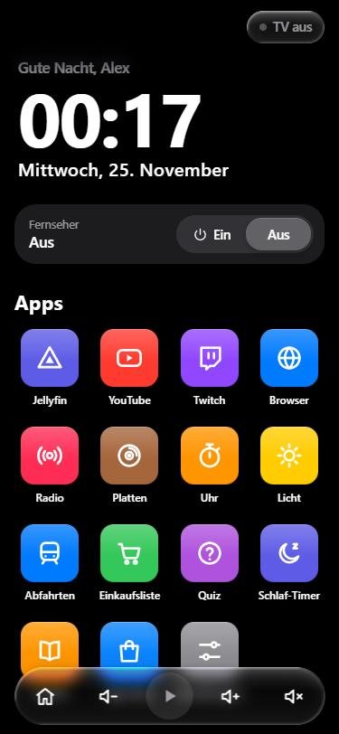
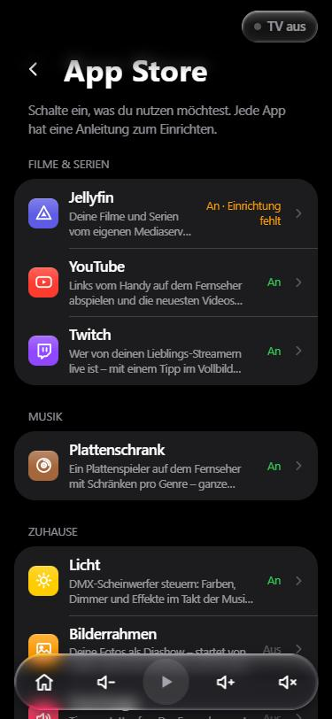
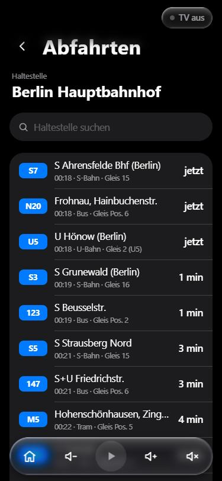
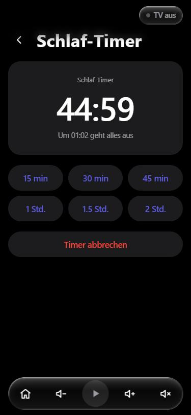

# RPi TV

**Ein Raspberry Pi macht aus jedem Fernseher ein kleines Zuhause-System – gesteuert mit dem Handy.**

**[▶ Live-Vorschau ausprobieren](https://t0n3y.github.io/tv-jarvis/)** – Fernbedienung und Fernseher direkt im Browser (Tablet oder Computer), ohne Installation.

Morgens geht der Fernseher von selbst an, zeigt Wetter, Termine, ToDos,
Vertretungsplan und die nächsten Busse und liest alles vor. Danach läuft
Radio. Den Rest des Tages ist er Mediacenter, Plattenspieler, Bilderrahmen
oder Quizshow. Bedient wird alles über eine Fernbedienungs-Web-App im
Apple-Stil, und mit eigenen Apps lässt sich das System erweitern.

<p align="center">
  
</p>
<p align="center">
  
  
  
  
</p>

- **Ein Befehl** installiert alles, eingerichtet wird in der Fernbedienung
- **Wecker** mit Morgen-Ansage, Dashboard und Radio
- **App Store** mit 19 Apps: Jellyfin, YouTube, Twitch, Plattenschrank, Licht, Comics, Kalender, IServ, Abfahrten, Quiz und mehr
- **Eigene Apps** als Ordner: `python -m app.new_app "Name"`, dazu Teilen per Git-Link
- **Updates, Backup und Neustart** per Knopfdruck
- Läuft komplett lokal auf dem Pi, ohne Cloud-Konto

## Installation: ein Befehl

Du brauchst:

- einen **Raspberry Pi 4 oder 5** mit **Raspberry Pi OS (64 Bit, mit Desktop)**
  und Internet (am besten per LAN-Kabel),
- einen **Fernseher mit HDMI-CEC**, damit der Pi ihn ein- und ausschalten
  kann. Je nach Marke heißt das *Anynet+* (Samsung), *Bravia Sync* (Sony),
  *SimpLink* (LG) oder *EasyLink* (Philips). Bei Samsung zusätzlich
  „Automatisches Ausschalten“ aktivieren.

Auf dem Pi ein Terminal öffnen (oder per SSH) und eingeben:

```bash
curl -fsSL https://raw.githubusercontent.com/t0n3y/tv-jarvis/main/scripts/install.sh | bash
```

Das Skript fragt einmal nach deinem Passwort (für `sudo`). Danach erledigt es
alles: Systempakete, Python-Umgebung, deutsche Stimme (Piper), Geräte-Rechte,
automatische Desktop-Anmeldung und den Systemdienst. Zum Schluss zeigt es
eine Adresse und einen **QR-Code** an.

## Einrichtung: in der Fernbedienung

QR-Code mit dem Handy scannen (gleiches WLAN) oder
`http://<name-des-pi>.local:8080/remote.html` öffnen. Ein Assistent führt in
vier Schritten durch die Einrichtung:

1. **Name** des Systems, dein Vorname und dein Ort fürs Wetter
2. **Fernseher**: Der Pi sucht den HDMI-Anschluss selbst. Mit „Fernseher
   testen“ geht der Fernseher an und sagt Hallo.
3. **Apps** auswählen
4. **Passwort** für die Fernbedienung (wird vorgeschlagen)

Tipp fürs iPhone: In Safari *Teilen → Zum Home-Bildschirm* tippen, dann liegt
die Fernbedienung wie eine normale App auf dem Home-Bildschirm.

## App Store

Im **App Store** in der Fernbedienung schaltest du Apps ein und aus. Jede App
hat eine Schritt-für-Schritt-Anleitung. Bei Apps mit Zugangsdaten gibt es
außerdem „Verbindung testen“.

| App | Was sie macht | Was du brauchst |
| --- | --- | --- |
| **Jellyfin** | Filme und Serien vom eigenen Mediaserver, Weiterschauen, Upload vom Handy | Jellyfin-Server + API-Schlüssel |
| **YouTube** | Links vom Handy abspielen, neueste Videos deiner Abos | für Abos: einmal im TV-Browser anmelden |
| **Twitch** | Lieblings-Streamer: wer ist live, Stream im Vollbild ohne Chat | nichts |
| **Plattenschrank** | Plattenspieler auf dem Fernseher, Schränke pro Genre | nichts |
| **Licht** | DMX-Scheinwerfer, Farben und Effekte im Takt | uDMX-USB-Adapter |
| **Comics** | Reader mit Doppelseiten und Blätteranimation (CBZ/CBR/PDF) | nichts |
| **IServ-Vertretungsplan** | Vertretungen für deine Kurse auf dem Dashboard und im Wecker | IServ-Zugang |
| **Google / iCloud Kalender** | Termine auf dem Dashboard und im Wecker | iCal-Adresse bzw. App-Passwort |
| **ToDos aus Notizen** | Checkliste aus der Notizen-App | iPhone-Kurzbefehl |
| **Fernzugriff** | Fernbedienung von unterwegs mit https | Cloudflare-Konto + Domain |
| **Pinnwand** | Beispiel-App: Nachricht vom Handy groß auf den Fernseher | nichts |
| **Durchsage** | Tippen statt rufen: Der Fernseher spricht deine Nachricht | nichts |
| **Abfahrten** | Nächste Busse/Bahnen auf dem Dashboard und im Wecker | nichts (Transitous, kostenlos) |
| **Bilderrahmen** | Fotos als Diashow, startet von selbst, wenn nichts läuft | Foto-Ordner auf dem Pi |
| **Einkaufsliste** | Gemeinsame Liste für den Haushalt, auch auf dem Dashboard | nichts |
| **Schlaf-Timer** | Nach X Minuten leiser werden, dann alles aus | nichts |
| **WLAN-Lampen** | LSC-/Tuya-/Smart-Life-Lampen: an/aus, Helligkeit, Farben, Szenen | Tuya-Entwicklerkonto (einmalig) |
| **Quiz** | Quizabend: Fragen auf dem Fernseher, Antworten per Handy | nichts |

Apps, die aus sind, verschwinden vom Homescreen der Fernbedienung und vom
Dashboard auf dem Fernseher.

## Funktionen im Überblick

**Fernseher**
- Dashboard mit Uhr, Wetter, Terminen, ToDos, Vertretungsplan und Kacheln
  eigener Apps (z. B. Abfahrten, Einkaufsliste). Ausgeschaltete Apps
  verschwinden, die Spalten ordnen sich neu.
- Ein- und Ausschalten über HDMI-CEC, mit Start- und Abschiedsanimation.
- Wecker: zur eingestellten Zeit an, Morgen-Ansage mit natürlicher Stimme
  (Piper, offline), danach Radio. Zum Verlassen-Zeitpunkt wieder aus.

**Fernbedienung** (Web-App, auf dem iPhone per *Zum Home-Bildschirm*)
- Fernseher an/aus, Lautstärke, Wiedergabe-Steuerung im Dock.
- Apps: Jellyfin (mit Weiterschauen und Upload), YouTube (Links und Abos),
  Twitch, Radio, Plattenschrank, Uhr/Timer, Licht, TV-Browser mit
  Handy als Touchpad und Tastatur, Comics und alle Apps aus dem App Store.
- Einstellungen: Name, Weckzeiten, Kurse und Fächer, Radiosender, Passwort,
  Updates, Backup.

**Sicherheit**
- Die Fernbedienung ist mit einem Passwort geschützt (Pflicht bei der
  Einrichtung).
- Zugangsdaten liegen nur in `.env` auf dem Pi und erreichen nie den Browser.
- Anfragen über einen Tunnel (z. B. Cloudflare) zählen nie als „lokal“.
- Für den Zugriff von unterwegs: App *Fernzugriff* (Cloudflare-Tunnel,
  empfohlen mit Cloudflare Access).

## Eigene Apps bauen

Eine App ist ein Ordner in [`apps/`](apps) – mit Steckbrief (`app.json`),
Ansicht für die Fernbedienung, Seite für den Fernseher und auf Wunsch einer
eigenen API in Python. Sie erscheint automatisch im App Store, mit Schalter,
Einstellungen und Anleitung. Eine fertige Vorlage erzeugt:

```bash
.venv/bin/python -m app.new_app "Meine App"
sudo systemctl restart dashboard.service
```

Alles Weitere – Bausteine, `RPiTV.app()` im Browser, `ctx` im Server – steht in
[apps/README.md](apps/README.md). Weitergeben: als Git-Repo, andere fügen den
Link im App Store unter **App hinzufügen** ein.

## Aktualisieren, Backup, Neustart

In der Fernbedienung unter **Einstellungen → System**:

- **Updates**: zeigt neue Versionen mit den Änderungen an und installiert sie
  per Knopfdruck. Der Pi startet danach kurz neu, Fernseher und Radio laufen
  weiter. Hast du selbst Dateien im Projekt geändert, aktualisiert er nicht
  automatisch.
- **Backup herunterladen / einspielen**: Einstellungen, App-Daten und Listen
  als eine ZIP-Datei – auf Wunsch mit Zugangsdaten. Ideal vor einer
  Neuinstallation.
- **Neu starten**: startet den Dienst neu (z. B. nach einer neuen App).

Alternativ den Installationsbefehl noch einmal ausführen.

## Anpassen

Das ganze Projekt ist offen: Du darfst es für dich umbauen (Lizenz siehe
unten).

- **Name**: *Einstellungen → Allgemein*. Ersetzt „RPi TV“ überall.
- **Eigene Apps**: siehe nächster Abschnitt.
- **Einstellungen als Datei**: Alle Standardwerte stehen in
  `config.example.yaml`. Wer lieber Dateien bearbeitet, kopiert sie nach
  `config.yaml`. Es gilt die Reihenfolge
  `config.example.yaml` → `config.yaml` → `data/settings.json`
  (Fernbedienung), also überschreibt jede Ebene die vorige.
- **Eigener Fork**: Mit dem Installer kannst du auch deinen eigenen Fork
  installieren:
  `curl -fsSL …/install.sh | RPITV_REPO=https://github.com/<du>/tv-jarvis.git bash`

## Fehlersuche

```bash
systemctl status dashboard.service        # läuft der Dienst?
journalctl -u dashboard.service -e        # Log
sudo systemctl restart dashboard.service  # neu starten
./scripts/quick_test.sh 120               # Weckvorgang sofort testen
```

- **Fernseher geht nicht an**: HDMI-CEC am Fernseher prüfen, dann
  *Einstellungen → Fernseher & Ton testen*. Der Pi 4 hat zwei HDMI-Ports mit
  je eigenem CEC-Adapter (`/dev/cec0`, `/dev/cec1`). Der Test erkennt den
  richtigen Port neu.
- **Kein Ton**: ebenfalls *Fernseher & Ton testen*. Es setzt die
  HDMI-Tonausgabe (`plughw:CARD=vc4hdmi0|1,DEV=0`) passend zum Port.
- **Vertretungsplan leer**: Jede Schule baut IServ etwas anders. Die Pfade
  „Vertretung heute/morgen“ im App Store prüfen. Klassischer IServ-Plan statt
  Untis: Selektoren unter `iserv.selectors` in `config.yaml` anpassen.
- **Stimme fehlt**: Den Installer erneut ausführen. Er lädt
  `de_DE-thorsten-medium` von
  [huggingface.co/rhasspy/piper-voices](https://huggingface.co/rhasspy/piper-voices)
  nach `data/piper-voices/`.
- **Songs/Videos laden nicht mehr**: YouTube ändert sich oft. Dann hilft
  `.venv/bin/pip install -U "yt-dlp[default]"`.

## Fernseher ohne HDMI-CEC

Standard ist HDMI-CEC. Kann dein Fernseher das nicht (oder nur unzuverlässig): `tv_control.backend: smart_plug` in
`config.yaml` setzen und `app/tv_control/smart_plug.py` mit der passenden
Bibliothek für eure Steckdosenmarke füllen (Kommentare in der Datei enthalten
konkrete Empfehlungen je nach Marke).
## Projektaufbau

```
app/
  config.py            Einstellungen laden (Standardwerte -> config.yaml -> data/settings.json)
  settings_store.py     Speichert, was in der Fernbedienung eingestellt wird (+ .env)
  apps.py               App Store: Apps, Felder, Anleitungen, Verbindungstests
  plugins.py            Laedt eigene Apps aus apps/ (+ ctx fuer deren server.py)
  new_app.py            Vorlage fuer eine neue App: python -m app.new_app "Name"
  system_tools.py       Neustart, Updates, Backup, Apps per Link installieren
  briefing.py           Sammelt alle Quellen parallel, baut Text + JSON
  tts.py                 Piper-Wrapper
  radio.py                mpv-Steuerung, spielt den aktuell gewaehlten Sender
  radio_stations.py        Sender-Liste + aktueller Sender (data/radio_stations.json)
  schedule_store.py         Laufzeit-Zeitplan, per Einstellungen-App editierbar
                             (data/schedule.json)
  scheduler.py               In-Prozess-Scheduler in dashboard.service - loest
                              morning_routine/leave_routine zur konfigurierten
                              Zeit aus (ersetzt die frueheren systemd-Timer)
  tv_power.py                 Gemeinsames An/Aus (Routinen + Fernbedienung)
  kiosk_media.py                YouTube-/Jellyfin-Steuerung (WebSocket-Broadcast)
  jellyfin_client.py             Jellyfin-REST-API (Bibliothek, Details, Position)
  vinyl_library.py               Plattenschrank: Sammlung + Suche (iTunes, YouTube)
  lighting/                      uDMX-Treiber + Licht-Engine (BPM-Effekte)
  audio_control.py               Lautstaerke ueber PipeWire/wpctl
  sources/                        Wetter, Google-ICS, iCloud-CalDAV, IServ, ToDos
  tv_control/                      CEC- und Steckdosen-Backend (austauschbar)
  dashboard/                        FastAPI-Server + Frontend (static/:
                                     index.html/app.js fuers Kiosk-Fenster,
                                     remote.html/css/js fuers Handy)
  routines/                          morning_routine.py / leave_routine.py
systemd/                              dashboard.service-Vorlage (von install.sh
                                       gerendert - der einzige systemd-Dienst,
                                       der Zeitplan laeuft in-Prozess mit)
scripts/install.sh                     Installation mit einem Befehl (curl | bash)
scripts/fix_audio_sink.sh               Setzt HDMI als PipeWire-Standardausgabe
                                         (per labwc-Autostart bei jedem Login)
apps/                                   Eigene Apps (je ein Ordner, Anleitung: apps/README.md)
docs/screenshots/                       Bilder fuer diese README
```

Alle Einstellungen mit Erklärung stehen in `config.example.yaml`.

## Lizenz

[PolyForm Noncommercial 1.0.0](LICENSE.md). Du darfst den Code frei nutzen,
verändern und weitergeben, aber **nicht kommerziell**: kein Verkauf, kein
Einsatz in einem bezahlten Produkt oder einer bezahlten Dienstleistung. Private
Nutzung, Schulen, Vereine und Forschung sind ausdrücklich erlaubt.

Weil kommerzielle Nutzung ausgeschlossen ist, ist das „source available“ und
keine Open-Source-Lizenz im Sinne der OSI.
